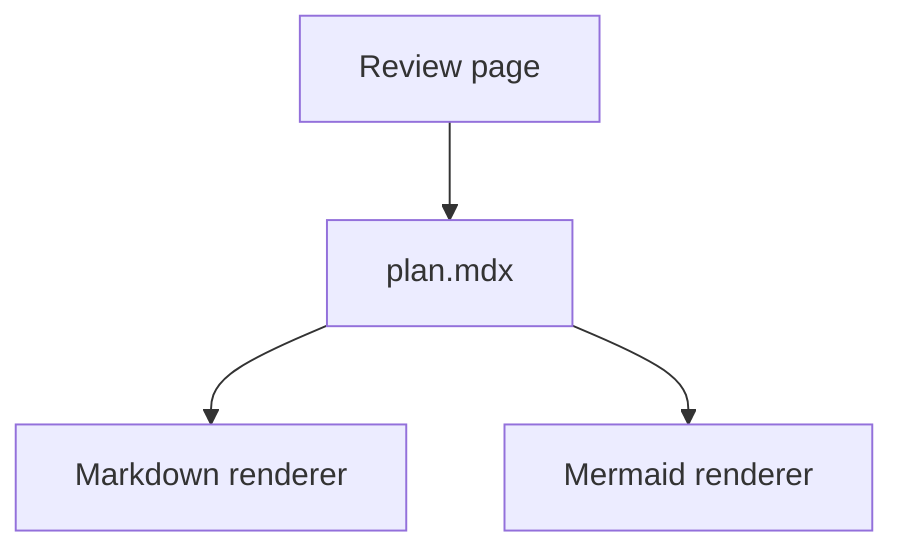

<required>
CRITICAL. Add the following steps to your task list:

1. Obtain the completed plan; use `writing-plans` first if planning is still needed.
2. Copy the bundled scaffold to `plans/SLUG/` and write the plan to `plan.mdx`.
3. Add or improve diagrams only where they clarify an important relationship.
4. Serve the directory locally and inspect the rendered page.
5. Report the source path and preview URL.
</required>

# Presenting Plans as HTML

Change only the presentation. Preserve the plan's decisions, scope, ordering,
and level of detail. Never add approval gates, planning methodology, hosted
services, comments, canvases, or prototypes.

## Quick scaffold

```sh
mkdir -p plans/SLUG
cp -R "{{skills_dir}}/presenting-html-plans/assets/scaffold/." plans/SLUG/
```

Replace `plans/SLUG/plan.mdx` with the completed plan. Use only Markdown,
fenced code, fenced Mermaid, tables, images, and simple HTML. The viewer
sanitizes HTML and never compiles JSX.

Serve the directory with any static server, for example:

```sh
python3 -m http.server 4173 --directory plans/SLUG
```

Open `http://localhost:4173/`. To preview another top-level `.md` or `.mdx`
file in the same directory, add `?src=other-plan.mdx`. The viewer rejects nested
and remote paths.

## Presentation rules

- Remove references that need chat history.
- Reorganize only when it makes the plan clearly easier to scan.
- Lead with the outcome. For an abstract product plan, place one concrete
  screenshot or example near the top when one already exists.
- Use a file-map table instead of a long prose list of files.
- Put each diagram beside the claim it explains. Do not repeat the same
  information in both prose and a diagram.
- Keep product screenshots and architecture diagrams separate. Never draw file
  paths, contracts, or implementation annotations inside product UI.
- Put unresolved questions in one final `Open Questions` section. Never invent
  questions to fill it.

## Mermaid

Use fenced `mermaid` blocks:

````markdown

````

Pick the diagram type by relationship:

- `flowchart` for architecture, ownership, dependencies, or data flow.
- `sequenceDiagram` for ordered interactions between actors.
- `stateDiagram-v2` for lifecycle and transition rules.
- `erDiagram` for persistent entities and relationships.

Default to grouped regions, layers, before/after views, and top-to-bottom
layouts. Use a linear chain only for a truly sequential relationship. Keep
labels short and use real domain terms. If a small table or paragraph is
clearer, skip the diagram.

## Theme

The scaffold uses the shared `paper` (light) and `carbon` (dark) palettes from
`THEME.md`. The page follows the reader's OS setting. For a capture or a shared
link, pin one with `?theme=paper` or `?theme=carbon`. Print uses black on white.

Never hard-code colours in a diagram. Never add a hue to the stylesheet.

## Handoff check

Open the rendered page before you share it. Check the table of contents,
Mermaid rendering, code overflow, table width, contrast, narrow-screen layout,
and print preview. Fix clipped content, excess whitespace, and unreadable
diagrams.

The scaffold fetches pinned DOMPurify, `marked`, and Mermaid from jsDelivr at
preview time. If the page must work offline, vendor those libraries. Never relax
the CSP or remove sanitization to make content render.
